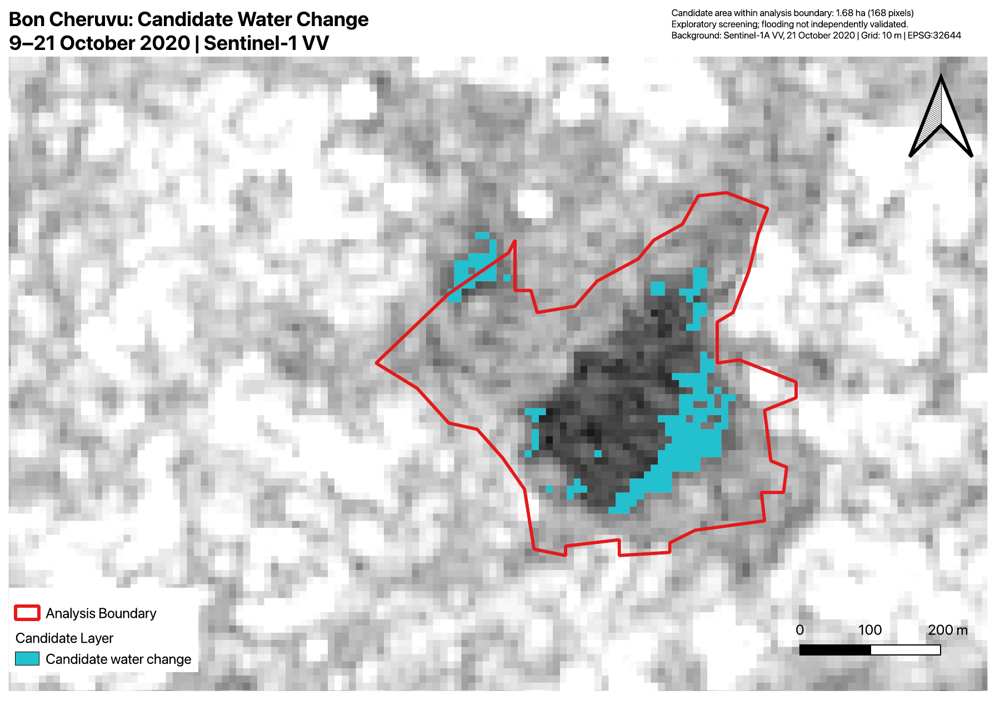

# Bon Cheruvu: Candidate Water Change

A QGIS and Python study of Sentinel-1A VV backscatter around Bon Cheruvu, Hyderabad, between **9 and 21 October 2020**.

The screening identifies **1.68 ha (168 pixels)** inside a manually defined analysis boundary and **2.51 ha (251 pixels)** across the full raster. These are threshold-based water-change candidates. They are **not independently validated flood extent**, lake-area growth or permanent land-use change.



[View the map PDF](maps/bon_cheruvu_water_change_oct2020.pdf) · [Method and QGIS steps](docs/methodology.md) · [Verification results](results/verification.json)

## What I did

- Compared two Sentinel-1A acquisitions with the same descending pass and relative orbit (165).
- Calculated the VV difference on an aligned 10 m grid in EPSG:32644.
- Combined darkening, pre-date water exclusion and post-date water thresholds.
- Used QGIS zonal histogram to count candidates inside the analysis polygon.
- Created a print layout with the boundary, legend, scale bar and interpretation note.
- Reproduced the mask and counts in Python and checked sensitivity to nearby thresholds.

## Results

| Scope | Valid pixels | Candidate pixels | Candidate area |
|---|---:|---:|---:|
| Full raster footprint | 104,608 | 251 | 2.51 ha |
| Analysis polygon | 1,725 | 168 | 1.68 ha |

Each grid cell covers 100 m², or 0.01 ha. Counts inside the polygon use pixel centres. The polygon is an analysis zone, not an independently surveyed shoreline or legal lake boundary. Cyan pixels outside it are visible on the map but are excluded from the 1.68 ha figure.

The Python result agrees with the original QGIS mask at every valid cell. The reproduced polygon histogram is **1,557 noncandidate pixels and 168 candidate pixels**. Agreement verifies implementation, not classification accuracy.

## Screening rule

```text
change = VV_21_Oct - VV_09_Oct
candidate = (VV_09_Oct >= -15 dB)
        AND (VV_21_Oct < -15 dB)
        AND (change <= -3 dB)
```

The -15 dB threshold is a preliminary way to distinguish dark, water-like surfaces. Excluding pre-date pixels below this threshold does not remove every existing-water pixel. Brightness changes within existing water can still pass the rule.

## Reproduce the analysis

Python 3.10+ with Rasterio, GeoPandas and NumPy:

```bash
python -m venv .venv
source .venv/bin/activate
python -m pip install -r requirements.txt
python scripts/analyze.py
```

The two small, clipped input rasters and the analysis polygon are included. No Earth Engine account or online download is needed to reproduce the local calculation. The script checks grid alignment, source validity, exact agreement with the original QGIS mask and agreement with the saved zonal histogram. It writes an integer candidate raster, area tables, sensitivity results and a verification report to `results/`.

To keep the supplied outputs untouched:

```bash
python scripts/analyze.py --output-dir /tmp/bon-cheruvu-check
```

For the editable map, open **`qgis/bon_cheruvu_oct2020.qgz`** in QGIS. The project uses relative paths; keep the folder structure together. The print layout is named **Bon Cheruvu water-change screening**. The original work used QGIS 3.44.13.

## Sensitivity and interpretation

I varied the water threshold from -16 to -14 dB and the darkening threshold from -4 to -2 dB (nine combinations). Candidate area inside the polygon ranged from **1.21 to 1.94 ha**. This is a sensitivity range for those choices, not an uncertainty interval or accuracy assessment. See [the full table](results/threshold_sensitivity.csv).

The visual comparison did not establish shoreline expansion confidently. The appropriate finding is that the selected rule detects localized backscatter changes requiring further investigation.

Limitations:

- Two acquisitions cannot describe the full event or establish peak inundation; short-lived water between dates may be missed.
- No independent flood reference, field observations or classification accuracy assessment was used.
- No additional speckle filtering, terrain-slope exclusion or independently validated permanent-water mask was applied in this local workflow.
- Wind, surface roughness, vegetation, soil moisture, shadows and mixed pixels can affect radar backscatter.
- A 10 m output grid is a sampling interval; it does not imply 10 m independent spatial detail or subpixel boundary precision.
- The analysis boundary was manually defined and can affect the reported area.

A stronger flood assessment would use additional dates, independent water and flood references, and a documented validation procedure before reporting flood extent.

## Files

```text
data/inputs/    Clipped Sentinel-1A VV/VH rasters and analysis polygon
data/           Original QGIS mask and saved polygon histogram
scripts/        Reproducible local analysis
results/        Reproduced mask, area summary, sensitivity and checks
maps/           Reviewed PDF and PNG map exports
qgis/           Portable project with the editable layout
docs/           Method, provenance and file checksums
```

## Data and attribution

Contains modified Copernicus Sentinel data (2020), obtained from the Earth Engine `COPERNICUS/S1_GRD` collection. The [Earth Engine dataset documentation](https://developers.google.com/earth-engine/datasets/catalog/COPERNICUS_S1_GRD) describes its calibration, noise removal, terrain correction and dB values. This study uses those processed exports, rather than unprocessed radar measurements.

[Exact scene identifiers and provenance](docs/provenance.md) are included. Source imagery remains subject to the [Copernicus Sentinel data terms](https://developers.google.com/earth-engine/datasets/catalog/COPERNICUS_S1_GRD#terms-of-use). The analysis polygon is a project digitization, not an official boundary. No broader imagery licence is claimed by this repository.
